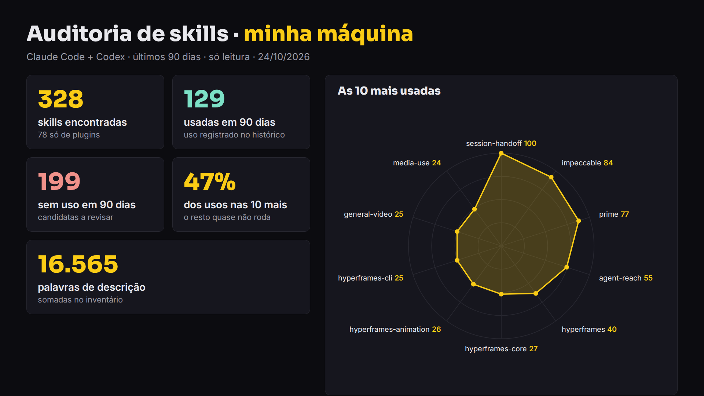

# Jogue fora os seus skills

Dicas, prompt e script para fazer a faxina das skills do seu agente (Claude Code, Codex e cia.) e ficar só com as que ainda ganham a vaga.

> Em 22/10/2026 a Anthropic doou o padrão **Agent Skills** para o Agentic AI Foundation, da **Linux Foundation** (a mesma casa do MCP). O formato fica. Mas os modelos de hoje precisam de cada vez menos "cola": skill demais polui o contexto e aumenta a chance de o modelo escolher a errada.

## O que tem aqui

| arquivo | o quê |
|---|---|
| [`COMECE-AQUI.md`](COMECE-AQUI.md) | como rodar a auditoria em 4 passos |
| [`PROMPT-AUDITORIA.txt`](PROMPT-AUDITORIA.txt) | o prompt em português, pronto para colar (só leitura, gera um relatório HTML) |
| [`TRES-PERGUNTAS.md`](TRES-PERGUNTAS.md) | as três perguntas para cada skill + a dica "skill na hora certa" |
| [`scripts/auditar_skills.py`](scripts/auditar_skills.py) | contagem local, sem IA e sem internet: quantas skills, quais você usa, peso das descrições |

## 10 dicas rápidas

1. **Cada skill instalada deixa nome e descrição em toda sessão.** Uma pesa pouco; cem juntas poluem o contexto.
2. **Cem skills são cem chances de escolher a errada.** Seis skills de design parecidas deixam o resultado sorteado, não melhor.
3. **Skill era muleta de modelo fraco.** Em 2025 o modelo precisava do passo a passo; os de hoje deduzem os próximos passos sozinhos.
4. **Muita skill cabe numa linha.** Ex.: em vez de uma skill de 300+ palavras que faz a IA te interrogar, uma linha no `AGENTS.md`: *"quando o pedido não estiver claro, me faça perguntas antes de começar."*
5. **Fica a skill que roda código exato** (o mesmo tratamento toda vez).
6. **Fica a skill que sabe o que o modelo não sabe** (seu processo, seus clientes, seu estilo) — desde que não repita o `memory.md`.
7. **Sai a skill que um conector/MCP oficial já resolve.** Confira antes se ele cobre a tarefa.
8. **Duas skills que se sobrepõem viram uma**, mais enxuta, com o melhor de cada.
9. **Nunca apague direto:** mova para uma pasta de backup com data.
10. **Skill rara entra na hora certa:** guarde numa pasta que o agente não carrega sozinho e peça "lê a skill X e segue" quando precisar.

## Prova real (máquina do INEMA, 24/10/2026)

Rodando `scripts/auditar_skills.py --dias 90 --projetos ~/projetos`:

- **328** skills encontradas, **78** só de plugins;
- **129** com uso registrado nos últimos 90 dias, **199** sem uso observado;
- as **10** mais usadas somam **47%** de todos os usos;
- **~16,5 mil** palavras de descrição somadas no inventário.

(Contagem local do histórico do Claude Code e do Codex; histórico ausente = uso desconhecido.)

## O processo, do início ao fim

| # | passo | comando | quem |
|---|---|---|---|
| 1 | Contar as skills e o uso (rápido, local) | `python3 scripts/auditar_skills.py --dias 90 --projetos ~/projetos --json auditoria.json` | ⚙️ script |
| 2 | Auditoria completa com relatório HTML | colar `PROMPT-AUDITORIA.txt` numa sessão nova do Claude Code/Codex | 🧠 você + agente |
| 3 | Ler o relatório e decidir (Manter/Juntar/Arquivar/Revisar) | abrir `auditoria-skills-AAAA-MM-DD/relatorio.html` | 🧠 você |
| 4 | Pedir a limpeza das skills escolhidas, com backup com data | "move as skills X, Y, Z para ~/skills-backup-AAAA-MM-DD" | 🧠 você + agente |
| 5 | Guardar as de uso raro fora da pasta carregada | mover para `~/skills-guardadas/` e chamar "lê a skill X e segue" | 🧠 você |
| 6 | Repetir a cada trimestre | voltar ao passo 1 | ⚙️ / 🧠 |

## Vídeo

Vídeo explicativo (16:9 e 9:16): links em [`VIDEOS.md`](VIDEOS.md).

---

Projetos e cursos abertos e gratuitos: **https://inema.club**
